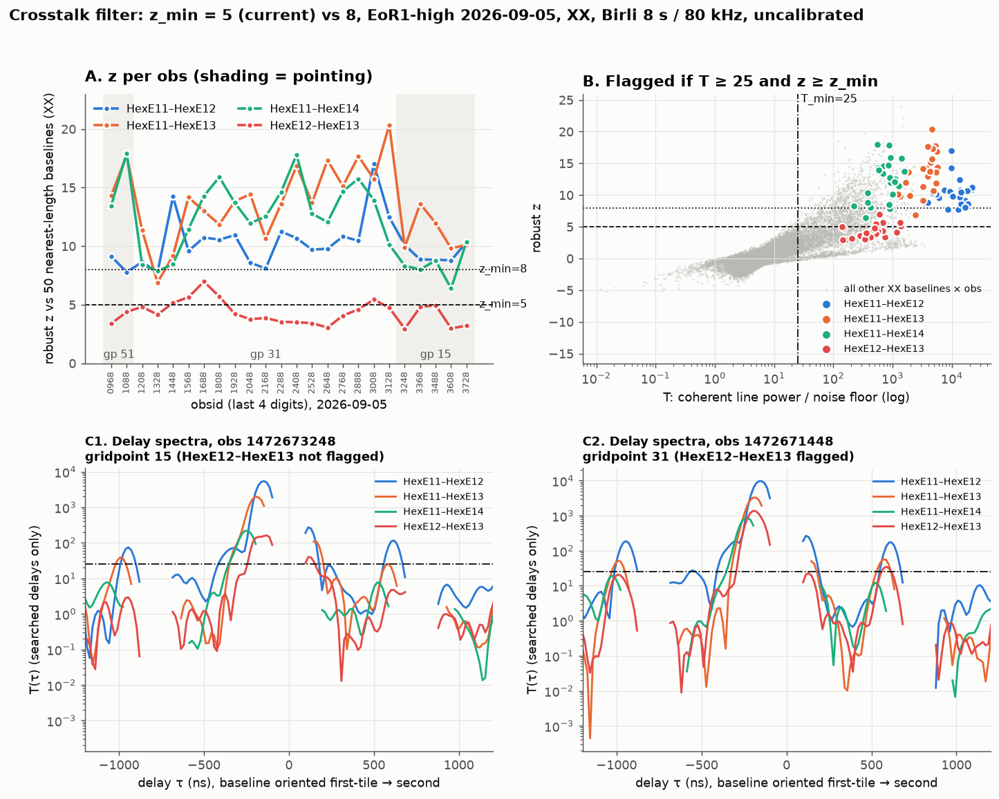

# Crosstalk QA: coherent delay-line outliers

Some MWA baselines carry a faint, non-fringing signal that sits at a fixed delay just beyond
the foreground horizon. It is too weak in amplitude for AOFlagger to catch, but it survives
coherent time averaging and shows up as a narrow line in the delay power spectrum. Left in,
it limits the power spectrum far above the expected 21 cm signal. `tools/crosstalk-qa` is a
prototype detector for these baselines that runs on Birli's output (uvfits or measurement
set). It reports and ranks suspect baselines; it does not write flags back into the data.



## Prior art

As far as we know, this effect was first reported by Yoshiura et al. (2026, PASJ 78, 1931,
§5.3 and Figs 12–14; [doi:10.1093/pasj/psag110](https://doi.org/10.1093/pasj/psag110)).
They found XX-only, one-sided delay power at k∥ ≈ 0.1–0.15 h Mpc⁻¹ on redundant 14 m
east-west baselines in 2023 ultralow Phase II drift scans, in fewer than 0.15 % of samples
but about an order of magnitude above the noise. They did not attribute it to a tile or
receiver. If you know of an earlier report, please open an issue so we can cite it.

A related, but more widespread, common-mode systematic was reported by Kolopanis et al.
(2023, MNRAS 521, 5120; [arXiv:2210.10885](https://arxiv.org/abs/2210.10885)) in 2016
Phase II data. That one is phase-stable and non-fringing too, but appears in both
polarisations on a large fraction of short baselines, so it looks like the same class of
problem rather than the same instance. Elder, Jacobs & Kovaleva (2024,
[arXiv:2411.04193](https://arxiv.org/abs/2411.04193)) model mutual coupling between
Phase II tiles electromagnetically; that is a candidate mechanism, not an observation of
this effect.

## What we see

In the Phase II compact data scanned so far (2023 ultralow drift scans and 35 EoR1
observations from the night of 2026-09-05), every observation shows the same pattern in XX:

- HexE11 is the "hub": its baselines to HexE12, HexE13 and HexE14 carry the line, while
  baselines between those partners mostly don't (HexE12–HexE13 carries a copy about ten
  times fainter, consistent with HexE11 leaking into both).
- Along the HexE12…HexE15 row the feature centre sits at |τ| = |b|/c + 53 ± 3 ns (98, 146,
  195 and 244 ns for 14, 28, 42 and 56 m). The excess delay is constant with distance, which
  points to propagation from HexE11 along the row rather than a fixed delay inside one
  receiver, so we call it coupling from HexE11, not receiver crosstalk.
- HexS13 is a similar hub in YY. Weaker, Kolopanis-like features appear in both
  polarisations on several same-receiver groups at 300–1100 ns.

The physical mechanism is still open.

## How the detector works

A leak of tile A's signal into input B adds a term ε⟨x_A x_A*⟩ to V_AB. In the zenith (drift)
frame that is a fixed-phase line, V_AB(t, f) += a·exp(2πi f τ₀), while sky foregrounds stay
within |τ| ≤ |b|/c plus some spectral broadening. The detector tests each baseline and
polarisation for one extra delay line beyond horizon + buffer:

1. **Coherent mean.** Average V(f) over unflagged timesteps. A channel is used if it is
   unflagged in at least 50 % of valid timesteps (`--min-chan-time-frac`).
2. **Remove the foreground.** Project out a DPSS (Slepian) basis band-limited to
   τ_cut = |b|/c + 50 ns (`--buffer-ns`), with 4 extra modes (`--fg-extra-modes`). This
   removes the foreground and its window and flag sidelobes. A plain delay cut on the raw
   spectrum does not: a Blackman–Harris main lobe alone reaches about 130 ns past the horizon
   at 30.72 MHz.
3. **Delay transform** of the residual with a Blackman–Harris taper, zero-padded ×2.
4. **Normalise.** Divide by the fraction of noise that survives the projection at each
   delay and by the noise floor (median power at |τ| ≥ 3000 ns / ln 2). Under noise the
   result T(τ) is exponential with unit mean.
5. **Search** |τ| > τ_cut, masking within τ_cut of each coarse-channel harmonic (781.25 ns),
   where edge flags and the PFB passband copy the foreground. The peak is the highest local
   maximum, so a skirt decaying from the cut is not mistaken for a line.
6. **Score** the peak by coherence across timesteps (noise ≈ 1/N_t, a fixed-phase line → 1),
   robust z of log₁₀T against the 50 baselines nearest in length, and one-sidedness
   T(τ_peak)/T(−τ_peak). An additive line puts power on one side only; a foreground skirt
   is roughly two-sided.
7. **Flag** when all of these hold:

   | criterion | default | flag | why |
   |---|---|---|---|
   | T ≥ t_min | 25 | `--t-min` | ~2×10⁶ trials per scan give ~3×10⁻⁵ false flags from Gaussian noise |
   | z ≥ z_min | 5 | `--z-min` | rejects systematics shared by similar-length baselines |
   | coherence ≥ coherence_min | 0.3 | `--coherence-min` | rejects transient RFI; skipped with fewer than 4 timesteps |
   | one-sided ≥ onesided_min | 6 dB | `--onesided-min-db` | rejects two-sided foreground leakage |
   | T / T(other pol) ≥ asym_min | off | `--asym-min` | optional polarisation asymmetry |

Delay sign: a phase increasing with frequency at 2πτ₀ peaks at +τ₀. Swapping baseline order
flips the sign.

The tile summary ranks tiles by flagged-baseline count. A hub (at least two flags and more
than each partner) is the likely source, because a leak from A into B, C and D shows up on
A–B, A–C and A–D only.

## Usage

```sh
cd tools/crosstalk-qa
pip install -e '.[ms,test]'
crosstalk-qa OBS.uvfits --metafits OBS.metafits --out OBS_xt
```

This prints the flagged baselines, the top 15 by T and the implicated tiles, and writes
`OBS_xt.csv` (every searchable baseline) and `OBS_xt.json`. With `--metafits`, each row also
carries the receiver and slot of both tiles. The exit status is 2 if an input was refused.

Run it on uncalibrated Birli output with the full band. Data are unprojected to zenith unless
`--no-unproject` is given.

### Example output

Observation 1472673248 (EoR1, gridpoint 15, 2026-09-05), Birli 0.21 measurement set with all
24 coarse channels averaged to 8 s / 80 kHz, uncalibrated. It took 45–130 s, depending on
machine load:

```sh
crosstalk-qa ms/1472673248.ms --metafits raw/1472673248/1472673248.metafits --out 1472673248_xt
```

Abridged (`...` marks removed lines; pyuvdata's own log lines are dropped):

```text
# ms/1472673248.ms: 8128 bl x 15 t x 384 ch (30.72 MHz, delay res 32.6 ns), frame unprojected (zenith drift), pols ['XX', 'YY']
WARNING: unsearchable baselines per pol {'XX': 5840, 'YY': 5840} (of 8128): horizon+buffer plus coarse-harmonic masks cover all delays (|b| > ~100 m), or too few good channels
## flagged 89 (baseline, pol)
XX   HexE11-HexE12     14.0m hor    47ns peak    -146ns T    5456.1 z  10.1 coh 1.00 Tinc   372.2 sep 0.68 Tother    72.4 1side  15dB raw   -98ns   54dB raw1side  27dB Rx23/3-Rx23/4 FLAG
XX    HexE1-HexE3      28.0m hor    93ns peak    -326ns T    2139.1 z  10.7 coh 0.99 Tinc   131.6 sep 1.00 Tother   316.4 1side  33dB raw  -326ns   33dB raw1side  39dB Rx34/1-Rx34/3 FLAG
XX   HexE11-HexE13     28.0m hor    93ns peak    -195ns T    1969.8 z   9.9 coh 0.99 Tinc   127.4 sep 0.83 Tother     5.1 1side  17dB raw  -146ns   44dB raw1side  26dB Rx23/3-Rx23/5 FLAG
XX    HexE2-HexE3      14.0m hor    47ns peak    -179ns T    1609.6 z   8.5 coh 0.99 Tinc    86.1 sep 0.96 Tother   590.0 1side  28dB raw   -65ns   39dB raw1side  -5dB Rx34/2-Rx34/3 FLAG
XX   HexE10-HexE11     14.0m hor    47ns peak    +146ns T    1070.7 z   5.0 coh 1.00 Tinc    75.4 sep 0.68 Tother   128.3 1side  16dB raw   +49ns   48dB raw1side   4dB Rx23/2-Rx23/3 FLAG
...
YY   HexS12-HexS13     14.0m hor    47ns peak    +977ns T     883.8 z   8.7 coh 0.99 Tinc    38.9 sep 1.00 Tother     0.3 1side  26dB raw  +977ns   29dB raw1side  26dB Rx29/8-Rx30/1 FLAG
...
XX    HexE5-HexE11     14.0m hor    47ns peak    +130ns T     495.3 z   6.5 coh 0.98 Tinc    29.2 sep 0.46 Tother     1.1 1side   8dB raw   +49ns   50dB raw1side   6dB Rx34/5-Rx23/3 FLAG
...
XX   HexE11-HexE14     42.0m hor   140ns peak    -244ns T     219.5 z   8.3 coh 0.98 Tinc    16.2 sep 0.84 Tother     2.8 1side  23dB raw  -195ns   38dB raw1side  32dB Rx23/3-Rx23/6 FLAG
...
## top 15 by T
...
YY  Tile083-Tile084     9.5m hor    32ns peak    -342ns T    1642.3 z   2.1 coh 0.99 Tinc   101.6 sep 1.00 Tother     0.3 1side  27dB raw  -342ns   32dB raw1side  27dB Rx32/3-Rx32/4
...
## implicated tiles (HUB = likely leak source)
XX   HexE11 Rx23/3 n=5 same_rx=4 HUB partners=HexE5,HexE10,HexE12,HexE13,HexE14
XX    HexE3 Rx34/3 n=4 same_rx=3 HUB partners=HexE1,HexE2,HexE4,HexE33
XX  Tile045 Rx22/5 n=3 same_rx=3 HUB partners=Tile027,Tile046,Tile048
...
YY   HexS13 Rx30/1 n=10 same_rx=4 HUB partners=HexS12,HexS15,HexS16,HexS18,HexS20,HexS21,HexS24,HexS26,HexS27,HexS30
...
```

Reading a row: `hor` is the horizon delay |b|/c; `peak` and `T` are the searched peak and its
normalised power; `z`, `coh` and `1side` are the scores from step 6; `Tinc` is the
per-timestep (incoherent) power over its floor; `sep` is the fraction of noise surviving the
foreground projection at the peak; `Tother` is the other polarisation's T at the same delay;
`raw` / `raw1side` describe the unprojected spectrum's feature centre; `RxNN/S` is the
receiver and slot of each tile. The Tile083–Tile084 row shows a bright line (T = 1642) that
is not flagged because it does not stand out from other ~10 m baselines (z = 2.1).

The CSV has one row per searchable (baseline, pol) with these columns:

```text
file,pol,ant1,ant2,length_m,horizon_ns,tau_peak_ns,t,z,coherence,t_inc,sep,t_otherpol,onesided_db,tau_raw_ns,raw_db,raw_onesided_db,good_frac,same_rx,rx1,slot1,rx2,slot2,flag
```

The JSON is keyed by input path; each entry holds `warnings`, `tiles`, `frame`, `n_times`,
`bandwidth_hz`, `params` and `flagged`.

## Limitations

- **Bandwidth.** Delay resolution is 1/B. The detector refuses B < 10 MHz (fewer than 8
  coarse channels) unless `--force` is given, and warns below about 23 MHz, where a +195 ns
  line on a 14 m baseline gets too close to the foreground.
- **Features inside the cut.** A feature centred just inside τ_cut (HexE11–HexE12 at
  about −98 ns, cut 97 ns) is seen only through its skirt, so `tau_peak_ns` is the cut
  edge. Use `tau_raw_ns`, measured on the unprojected spectrum, for the centre.
- **Long baselines.** The harmonic masks cover every delay for baselines longer than about
  100 m, so those are reported as unsearchable. `--coarse-bw-hz 0` disables the masks at
  the cost of PFB-copy false positives. Between about 92 and 100 m the gaps between masks can
  be too narrow to hold a local maximum, so T is 0 and z comes out strongly negative (−7 to
  −13 in 1472673248). Treat z on those rows as meaningless.
- **Thresholds** were tuned on Phase II compact EoR1 and ultralow data. z_min = 5 keeps the
  faint HexE12–HexE13 copy in some observations; raising it to 8 drops that copy but also
  loses some HexE11 baselines.

A Rust port into Birli or hyperdrive is planned.

## References

- Yoshiura, S., Ito, T., Null, D., et al. 2026, PASJ, 78, 1931. doi:10.1093/pasj/psag110
- Kolopanis, M., Pober, J. C., Jacobs, D. C., & McGraw, S. 2023, MNRAS, 521, 5120. arXiv:2210.10885
- Elder, K., Jacobs, D. C., & Kovaleva, M. 2024, arXiv:2411.04193
